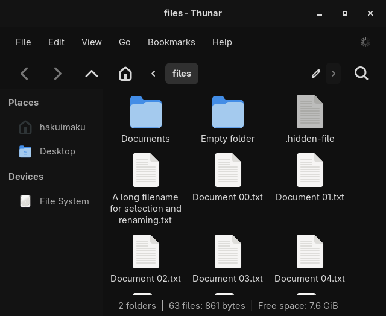
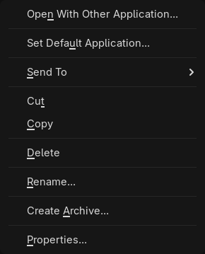
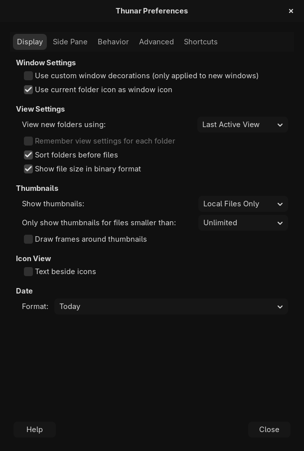
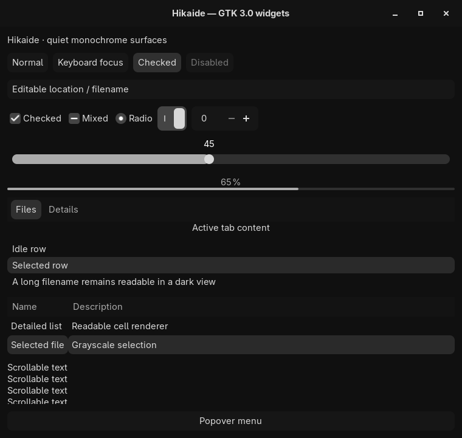
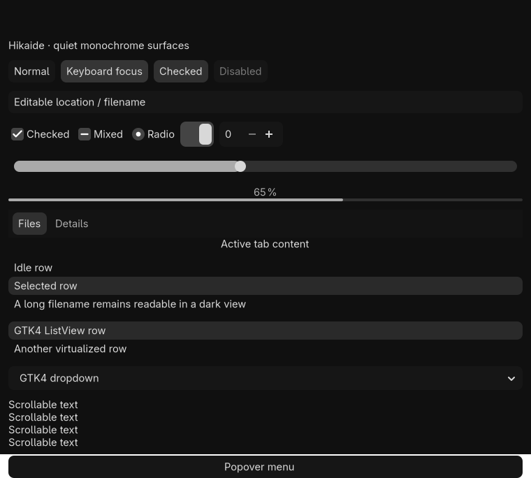

# Hikaide

A quiet, monochrome GTK3 and GTK4 theme inspired by HakuSpace, with Thunar as its main reference application.

Near-black surfaces, soft gray text, borderless controls, and subtle state changes keep the interface calm. Hikaide uses a `#101010` base, `#d8d8d8` text, 8px interactive corners, 200ms color fades, and opaque context menus. File chooser sidebars leave 12px between icons and labels.

## Preview

**Thunar** — spacious menus and navigation controls, a flat breadcrumb bar, and a subtly separated sidebar.



| Context menu | Preferences |
| --- | --- |
|  |  |

| GTK3 widgets | GTK4 widgets |
| --- | --- |
|  |  |

These are renders of real GTK widgets. Hikaide does not bundle icons or fonts. GTK4 file chooser lists prefer symbolic icons, which follow the theme's foreground color. GTK3 file chooser lists use Adwaita icons to keep fixed dark icons readable; other controls retain the selected icon theme.

## Install

From the repository root, run:

```sh
python3 scripts/install_gtk_theme.py
```

The default destination is `${XDG_DATA_HOME:-$HOME/.local/share}/themes/Hikaide`. For the traditional `~/.themes` location, use:

```sh
python3 scripts/install_gtk_theme.py --dest "$HOME/.themes"
```

No build step, Sass dependency, or root privileges are needed. The installer changes only the Hikaide theme directory and its backups. It leaves desktop settings, user CSS, icons, fonts, and cursors untouched.

The installer resolves CSS imports and indicator assets to their installed locations, so appearance managers can symlink `gtk.css` into a user configuration directory without breaking relative paths. Reinstall after moving the theme to a different location.

### Activate

Choose **Hikaide** in your existing GTK appearance manager, such as nwg-look or XFCE Appearance, then reopen applications as needed.

For sessions that use GSettings for GTK appearance:

```sh
gsettings set org.gnome.desktop.interface gtk-theme Hikaide
```

If your session uses xsettingsd or GTK settings files, select the same theme name through its existing appearance configuration. Hikaide does not install a settings service.

### Update and restore

Run the same installer command with the same destination to update. The installer stages the complete theme before replacing it and preserves the previous installation under `.Hikaide-backup-*/Hikaide` beside the destination. It refuses to replace symlinks or unrelated directories.

To restore a previous version, move the current Hikaide directory aside and copy the backed-up `Hikaide` directory back into the theme root. Keep backups until you have checked the update; remove older backups manually when no longer needed.

## Compatibility

| Target | Coverage |
| --- | --- |
| GTK3 | Common controls, menus, popovers, lists, tree views, tabs, and dialogs |
| Thunar | Icon, detailed and compact views; sidebar; toolbar; pathbar; context menus; workflow dialogs |
| GTK4 | Native entries, lists and grids, column headers, dropdowns, popover menus, headerbars, and common controls |

Both normal and dark variants use the same dark design. Error, warning, and success colors are reserved for semantic messages.

Hover fades apply to native controls such as buttons, menu items, tabs, and GTK4 list/grid items. Thunar's GTK3 file views and sidebar use shared cell renderers; this CSS theme cannot provide independent per-item fades there. That requires animation support in Thunar/Exo rather than additional CSS transition rules. See [GTK3's cell-rendering implementation](https://github.com/GNOME/gtk/blob/gtk-3-24/gtk/gtkcellrenderer.c#L749).

Verified with **GTK 3.24.52**, **GTK 4.24.1**, and **Thunar 4.20.10**, using widget renders, 18 automated Thunar scenarios, and installer tests. Physical pointer interactions, mounted volumes, compositor behavior, and long-running file operations still need a desktop acceptance pass.

GTK2, Qt, GNOME Shell, and window-manager decorations are outside the theme's scope. Libadwaita applications manage their own styling and may not adopt external GTK themes; Hikaide does not patch their stylesheets or inject global CSS. Flatpak and Snap applications may require the theme to be made available inside their sandbox.

## Development

```text
themes/Hikaide/
  index.theme
  assets/          Check, mixed-state, and radio indicators
  shared/          Named colors and common widget rules
  gtk-3.0/         GTK3 nodes and Thunar-specific styling
  gtk-4.0/         Native GTK4 styling
scripts/           Installer
tests/             Installer and GTK/Thunar runtime checks
docs/images/       Preview screenshots
```

Edit the palette in [colors.css](themes/Hikaide/shared/colors.css). Shared geometry and fades live in [widgets.css](themes/Hikaide/shared/widgets.css); Thunar-specific spacing lives in the [GTK3 stylesheet](themes/Hikaide/gtk-3.0/gtk.css). GTK3 has no numeric CSS variables, so related geometry rules are grouped directly in the stylesheets.

Run the installer tests:

```sh
python3 -m unittest discover -s tests -v
```

Render GTK widgets and exercise Thunar on private Broadway displays:

```sh
python3 tests/run_checks.py
python3 tests/run_checks.py --thunar
```

The render checks require Python/PyGObject with Cairo support and GTK3/GTK4 Broadway backends. The GTK3 timing check verifies intermediate hover colors on buttons, menu items, and list rows in both directions, and immediate state changes when animations are disabled. Thunar checks also require Thunar 4.20, a C compiler, `pkg-config`, GTK3 development headers, and `dbus-run-session`. No dependencies are downloaded automatically.

Tests use temporary XDG directories, private D-Bus sessions, and disposable file fixtures. Screenshots and logs go to `.test-output/`, or the directory supplied with `--output`. File-operation dialogs are closed without accepting operations; existing desktop settings and running Thunar instances are left alone.

Before committing, run:

```sh
git diff --check
git diff --cached --check
```

For platform details, see the [GTK3 CSS overview](https://docs.gtk.org/gtk3/css-overview.html), [GTK4 CSS overview](https://docs.gtk.org/gtk4/css-overview.html), and [theme loading documentation](https://docs.gtk.org/gtk4/class.CssProvider.html).
